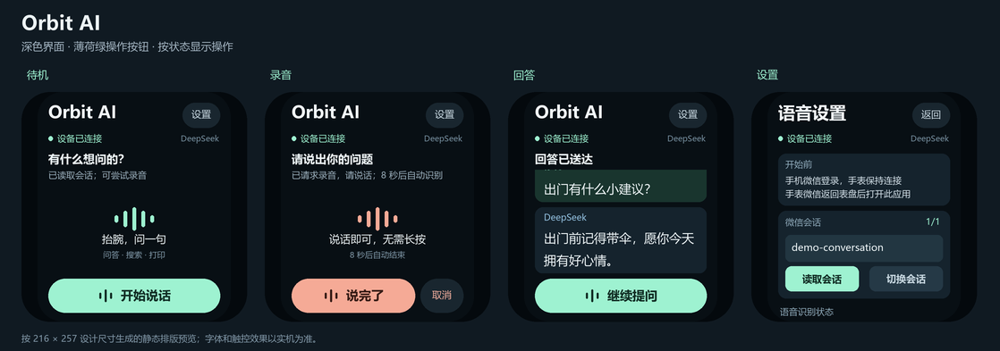

# Xiaomi Wearable Development Guide

Tools and documentation for developing third-party apps on Xiaomi smartwatches and smart bands using the Vela JS Quick App framework.

## Orbit AI Concept



## Supported Devices

| Device | Screen | Resolution | DP Width |
|--------|--------|-----------|----------|
| Xiaomi Watch S1 Pro | Round 1.47" | 480x480 | 240 |
| Xiaomi Watch S3/S4/S4 Sport/H1 | Round 1.43" | 466x466 | 233 |
| Xiaomi Watch S5 | Round 1.485" | 480x480 | 240 |
| Xiaomi Smart Band 8 Pro | Capsule 1.74" | 336x480 | 168 |
| Xiaomi Smart Band 9 | Capsule 1.62" | 192x490 | 96 |
| Xiaomi Smart Band 9 Pro | Capsule 1.74" | 336x480 | 168 |
| Xiaomi Smart Band 10 | Capsule 1.725" | 212x520 | 106 |
| REDMI Watch 5 | Rectangle 2.07" | 432x514 | 216 |

See the [multi-screen adaptation guide](https://iot.mi.com/vela/quickapp/en/guide/multi-screens/) for designing apps across devices.

## What's in this repo

- **`scripts/`** - CLI tools for building, deploying, and testing apps (no IDE required)
- **`examples/songbird/`** - A working example app (Hebrew lullaby songbook for Mi Band 8 Pro)
- **`docs/`** - Detailed documentation on the framework and deployment process

## Quick Start

### Prerequisites

- [AIoT IDE](https://iot.mi.com/vela/quickapp/en/) - VS Code fork for Vela development (includes emulator)
- [Node.js](https://nodejs.org/) >= 14
- [ADB](https://developer.android.com/tools/adb) (Android Debug Bridge)
- Android SDK with `javac` and `d8` (for real device deployment only)

### Build and deploy to emulator

```bash
# 1. Start the Vela emulator from AIoT IDE

# 2. Install script dependencies
cd scripts && npm install && cd ..

# 3. Build and deploy the example app
./scripts/emu-deploy.sh --project examples/songbird

# 4. Take a screenshot
node scripts/emulator-grpc.js screenshot /tmp/screen.png
```

### Deploy to real band

```bash
# Phone must be connected via ADB (USB or wireless)
# Mi Fitness app must be installed and paired with band

./scripts/deploy.sh --project examples/songbird

# Follow the prompt to tap the RPK file in the file picker
```

## How Vela JS Quick Apps Work

The band runs **Xiaomi Vela OS** (based on NuttX RTOS). Apps are built with the **Vela JS Quick App** framework - a Vue.js-like MVVM framework.

### Project structure

```
my-app/
├── src/
│   ├── manifest.json       # App config (package name, routes, designWidth)
│   ├── app.ux              # App lifecycle
│   ├── pages/
│   │   └── index/index.ux  # Page (template + script + style)
│   └── common/             # Shared assets and modules
├── package.json
└── dist/                   # Built .rpk files
```

### The .ux file format

Each page is a `.ux` file with three sections:

```html
<template>
  <div class="page">
    <text class="title">{{ message }}</text>
    <text onclick="handleClick">Tap me</text>
  </div>
</template>

<script>
export default {
  private: {
    message: "Hello Band!"
  },
  handleClick() {
    this.message = "Clicked!"
  }
}
</script>

<style>
.page {
  flex-direction: column;
  background-color: #000000;
}
.title {
  font-size: 20px;
  color: #ffffff;
}
</style>
```

### Key concepts

- **`designWidth`**: Set in `manifest.json`. This controls CSS-to-pixel mapping. Use the DP width from the device table above (e.g., `192` for Mi Band 8 Pro, `466` for Watch S3). The framework scales your CSS units to the actual screen resolution.
- **Flexbox layout**: All containers use flexbox. Default direction is `column`.
- **`<list>` for scrolling**: The `<list>` + `<list-item>` component is the most reliable way to display scrollable content. Each `<list-item>` needs an explicit `height`.
- **`<text>` is required**: All text must be inside a `<text>` element. Text placed directly in `<div>` won't render.

### Building

```bash
cd my-app && npm run build
```

Output: `dist/<package-name>.debug.<version>.rpk`

Bump `versionName` and `versionCode` in `manifest.json` before each deploy to the real device.

## Deploying to the Emulator

The emulator runs NuttX with ADB support. Apps are deployed via:

1. **Push** the `.rpk` to `/data/quickapp/app/<package>.rpk`
2. **Extract** with `adb shell unzip -o <rpk> -d <app-dir>`
3. **Start** with `adb shell "vapp app/<package> &"` (auto-kills previous instance)

```bash
./scripts/emu-deploy.sh --project <your-app-dir>
```

The `vapp` binary is the Quick App JS runtime on the emulator. Starting a new instance kills any previous one for the same package.

### Emulator gRPC control

The emulator exposes a gRPC server (default port 8554) for programmatic control:

```bash
node scripts/emulator-grpc.js screenshot /tmp/screen.png
node scripts/emulator-grpc.js click 168 240        # Mouse click (triggers onclick)
node scripts/emulator-grpc.js tap 168 240          # Touch event
node scripts/emulator-grpc.js swipe 10 240 300 240 # Swipe gesture
```

**Important**: Use `click` (sendMouse), not `tap` (sendTouch) for clicking UI elements. The Vela framework responds to mouse events but not always touch events in the emulator.

### Coordinate system

The emulator renders at the device's native resolution, but `designWidth` means CSS pixels != screen pixels. For gRPC commands, multiply CSS coordinates by `screen_width / designWidth`. For example, Mi Band 8 Pro: `336 / 192 = 1.75x`.

## Deploying to Real Device

There is no official way to sideload apps on the international Mi Band 8 Pro. This repo provides a workaround using a hidden debug page in the Mi Fitness app.

### How it works

1. A small `.dex` file runs via `app_process` on the phone
2. It loads Mi Fitness's APK classes via `PathClassLoader`
3. It launches the hidden `ThirdAppDebugFragment` via `ActivityManager`
4. ADB `input` commands automate the debug page UI (enter package name, tap install)
5. The Samsung file picker opens - you tap the RPK file to install

```bash
./scripts/deploy.sh --project <your-app-dir>
# The script handles steps 1-4 automatically
# You just tap the RPK file in step 5
```

### Requirements

- Phone connected via ADB (USB or wireless debugging)
- Mi Fitness app (`com.xiaomi.wearable`) installed and paired with the band
- Android SDK (`ANDROID_HOME` must be set or at `~/Library/Android/sdk`)

See [docs/deployment-real-device.md](docs/deployment-real-device.md) for the full technical deep-dive.

## Known Limitations

### Text rendering

- **LTR only**: The band renders all text left-to-right. For RTL languages (Hebrew, Arabic), you must pre-reverse the text. See the Songbird example for a `rev()` helper.
- **`<list-item>` is single-line**: Text inside `<list-item>` does not wrap to multiple lines regardless of the `lines` CSS property. Long text must be pre-split into separate list items.
- **Hebrew requires bold**: Hebrew glyphs only render at certain font sizes with `font-weight: bold`. 20px+ bold works reliably.

### Emulator

- **Missing fonts**: The emulator lacks Hebrew, Arabic, and many CJK glyphs. Hebrew shows as squares. Always test non-Latin text on the real device.
- **`<scroll>` component**: `scroll-y="true"` and a fixed `height` are required. Even then, finger scrolling may not work in the emulator. The `scrollTo()` and `scrollBy()` methods work programmatically.
- **Back navigation**: The `router.back()` call works, but triggering it via gRPC click on a back button is unreliable. Swipe-right gesture also doesn't work in the emulator.

### `<list>` component

- `scrollTo({index, behavior})` scrolls to a specific item
- `scrollBy({top, behavior})` scrolls by pixel offset
- These methods work on both emulator and real device
- Finger scrolling works on the real device but not always in the emulator

### General

- **No app store**: There is no official way to distribute third-party apps. Sideloading via the debug page is the only option.
- **Version bumping**: The band may cache old versions. Bump `versionCode` in `manifest.json` before each deploy. If the band still shows the old version, uninstall first.

## Development Workflow

1. **Edit** `.ux` files in AIoT IDE or any editor
2. **Build + deploy to emulator**: `./scripts/emu-deploy.sh --project <dir>`
3. **Screenshot**: `node scripts/emulator-grpc.js screenshot /tmp/screen.png`
4. **Iterate** on layout and logic using the emulator (fast cycle)
5. **Deploy to band**: `./scripts/deploy.sh --project <dir>` (for final testing, font rendering, touch behavior)

## Scripts Reference

| Script | Purpose |
|--------|---------|
| `scripts/deploy.sh` | Build + deploy to real band via phone |
| `scripts/emu-deploy.sh` | Build + deploy to emulator |
| `scripts/emulator-grpc.js` | Emulator control (screenshot, click, swipe) |

All scripts support `--help` for full usage. Configuration via CLI arguments or environment variables - no hardcoded device serials or paths.

## Resources

- [Vela Quick App Docs](https://iot.mi.com/vela/quickapp/en/) - Official framework documentation
- [AIoT IDE Download](https://iot.mi.com/vela/quickapp/en/guide/start/use-ide.html) - Development IDE

## License

MIT
